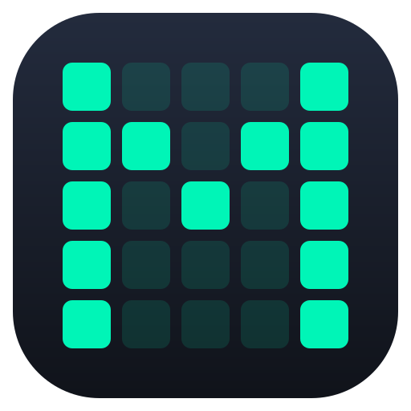
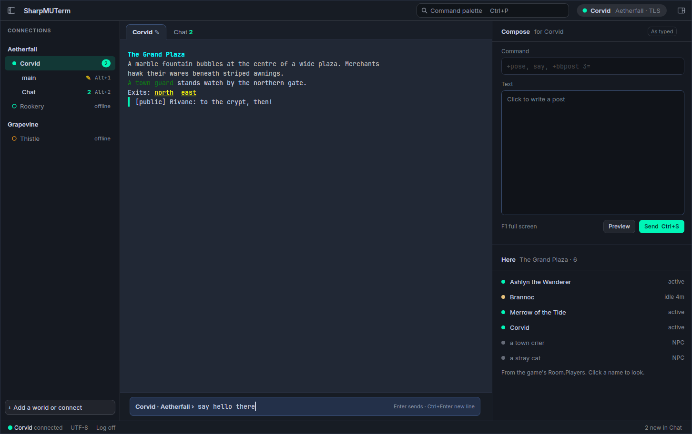
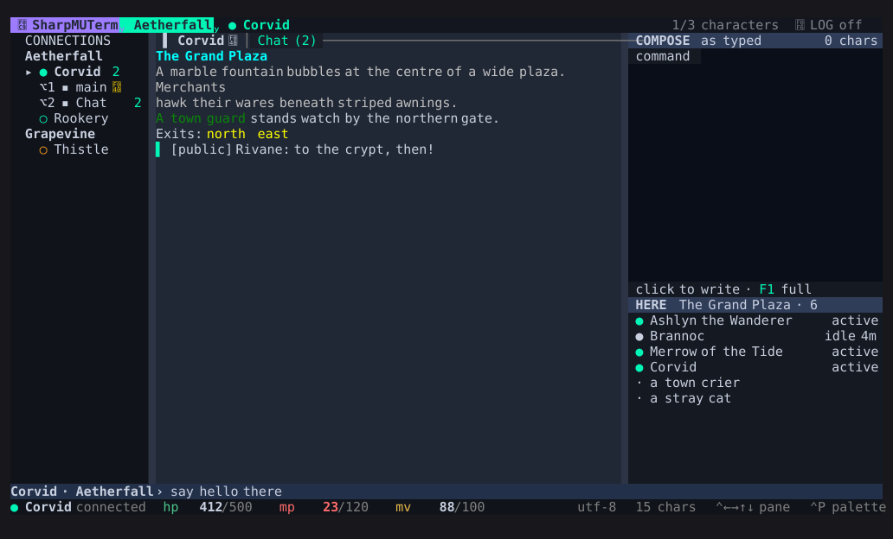

<p align="center">
  
</p>

<h1 align="center">SharpMUTerm</h1>

<p align="center">A MU* client for MUSH, MUCK and MUD players, in your terminal or in a window of its own.<br>
Windows and Linux · .NET 10 · MIT licensed</p>

<p align="center">
  
</p>

SharpMUTerm is one client with two front ends. `sharpmuterm` runs inside a terminal (kitty, WezTerm, Ghostty,
Windows Terminal and others). `sharpmuterm-window` is the same client in a desktop window, with native menus,
dialogs, a map, gauges and settings drawn by [Avalonia](https://avaloniaui.net/). Both read the same configuration,
take the same keys and connect to any world that speaks telnet.

> **Status:** early, and moving quickly. Each release's changes are in [`CHANGELOG.md`](CHANGELOG.md); the
> architecture and roadmap are in [`docs/PLAN.md`](docs/PLAN.md).

## Install

Download a package from the [latest release](https://github.com/SharpMUSH/SharpMUTerm/releases/latest). Each one
holds both programs, and none needs a .NET runtime.

| Platform | Package | What to run |
|---|---|---|
| Windows | `SharpMUTerm-<version>-win-x64-setup.exe` | Start menu ▸ SharpMUTerm opens the window. Tick *Add to PATH* to run `sharpmuterm` from any terminal. Installs per user, with no administrator prompt. |
| Windows | `sharpmuterm-win-x64.zip` | Unzip and run either `.exe`. |
| Linux | `SharpMUTerm-<version>-x86_64.AppImage` | `chmod +x` it and run it to open the window. Put `--terminal` first to run the terminal client instead. |
| Linux | `sharpmuterm-linux-x64.tar.gz` | Unpack and run either program. |

```bash
sharpmuterm                      # open with no connection; the welcome helps you add a world
sharpmuterm example.org 4000     # connect straight away (add --tls for TLS)
sharpmuterm --window             # the same, in the desktop window
sharpmuterm --help               # every option, the files it keeps, and the keys
```

macOS is not packaged yet.

## Terminal or window

<p align="center">
  
</p>

| | Terminal (`sharpmuterm`) | Window (`sharpmuterm-window`) |
|---|---|---|
| Drawn by | [SharpConsoleUI](https://github.com/nickprotop/ConsoleEx), in character cells | The same cells drawn with Skia, plus native Avalonia views over them |
| Pictures from a world | Kitty graphics in kitty, Ghostty and Rio; half-blocks elsewhere, with a Sixel overlay in Windows Terminal | Real bitmaps on every platform |
| Settings, palette, search, composer | Cell screens and pop-ups | Native windows, cards and editors built from the same models |
| Panels | Cell panes | Native map, gauges, who-here list and quick bar, which can pop out into their own windows |
| Newline in the command line | ⌥⏎ | ⌃⏎ or ⇧⏎ (⌥⏎ maximises) |
| Fonts | Your terminal's; a Nerd Font for the header and sidebar icons | Inter and JetBrains Mono bundled, icons included |

Everything a player can do is reachable in both. The two front ends share one application and one set of
view models (`SharpMUTerm.Client`), and the test suites draw every screen through both and compare them cell for
cell, so a feature cannot land in one and not the other.

## What it does

**Connecting**
- TCP with TLS and IPv6. Worlds hold characters, each with an optional saved login; passwords go to the
  system's credential store (Windows Credential Manager, the Secret Service keyring, the macOS Keychain), with an
  owner-only file only as the fallback.
- Browse public worlds from [mu\*index](https://mu-index.com) and connect from the listing. `telnet://` and
  `telnets://` links open in the client.
- Automatic reconnect after a dropped connection (never after you quit), per world.
- Import worlds, characters and automation from MUSHclient, Mudlet and TinTin++. Nothing is written until you
  accept the review.

**Protocols**
- Telnet negotiation through [TelnetNegotiationCore](https://github.com/HarryCordewener/TelnetNegotiationCore):
  NAWS (each pane reports its own size), TTYPE/MTTS, NEW-ENVIRON (MNES), CHARSET, EOR and GA prompts, MCCP,
  GMCP, MSDP, MSSP, MSP and MCP 2.1.
- ANSI colour in 16, 256 and 24-bit. MXP with its line-security model, custom elements and entities,
  clickable `<SEND>` links and menus, and inline `<IMAGE>`s. Pueblo, negotiated as servers announce it.
- GMCP and MSDP data feeds meters, the vitals panel, who is in the room, channel windows, Lua and a data viewer.
  GMCP `Char.Login`, `Client.Media` (MCMP sound), `External.Discord` presence and `Comm.Channel` are supported.
- MSSP reports are kept per server and shown on the world's info page.
- MOO verb and property editing over MCP simpleedit, in the composer.

**Reading**
- Split panes with tabs, spawn windows that triggers route lines into, and capture of GMCP channels into
  windows of their own. Layouts (Roleplay, Combat, or your own) arrange them per world or character.
- Scrolling back splits the pane, so new lines keep arriving underneath. Freeze a pane, search what it holds
  (⌃F, plain or regex, one window or all) and search older history (⌥H).
- Markers for where you stopped reading, in a window you were not watching and in the terminal you left.
- Panes come back after a restart with their last lines. Optional joining of lines the server hard-wrapped,
  highlighted names, timestamps, links detected in plain text, emoji substitution.
- Themes (Dark, Light, Solarized Dark) with a contrast floor applied to every colour the client paints, and a
  colour per character for their panes and command line.

**Writing**
- A command line that grows as you type, with undo, selection, per-window drafts, per-character history (⌃R
  searches it), word completion from the room and the output, and optional command stacking.
- F1 opens a full-screen composer for long posts: line breaks are sent as `%r`, with a literal mode that escapes
  MUSH code, a preview of what will be sent and spell checking (Hunspell dictionaries, downloaded on request).
- A send group sends one line to several characters. A MUSH edit grab lands on the command line, never sent.

**Automation and scripting**
- Triggers (regex, wildcard, starts with, contains) that gag, highlight, rewrite, respond, route or run a
  script, built from a selection in the output with a live test against recent lines. Aliases, key bindings,
  timers, all held in named trigger sets shared between characters.
- Sandboxed Lua 5.2 through [MoonSharp](https://www.moonsharp.org/): `world`, `output`, `trigger`, `alias`,
  `timer`, `gmcp`, `msdp`, `map`, `store` and more, with an in-app editor and a console per character.
- Packages: a zip of trigger sets, scripts and sound that installs after a review of what it can do as you.

**Maps and panels**
- An automapper fed by GMCP room data or text patterns, with areas, levels, hand editing and undo, and
  speedwalking that waits for each room to arrive.
- Panels for vitals, who is here, a quick bar of key bindings and a docked composer.

**Sound and alerts**
- MCMP and MSP sound through [SoundFlow](https://github.com/LSXPrime/SoundFlow), with captions when there is no
  audio device.
- Desktop alerts when you are paged or named while away, and a list of recent alerts.

**Accessibility**
- `--plain` runs the client as plain lines on stdin and stdout for screen readers. The window has live regions
  for output and notices, and every native control is named and reachable by Tab.

**Logs**
- Plain-text and HTML session logs, and scene logs that keep only the poses.

## Keys

| Key | Does |
|---|---|
| ⌃P | Command palette: every action, searchable |
| F1 | Composer |
| F2–F10 | Triggers, aliases, keys, worlds and characters, timers, text and display, input, characters, packages |
| ⌃F / ⌥H | Search the panes / search older history |
| ⌃R | Search command history |
| ⌥1–⌥9 | Go to a numbered window (the sidebar shows the numbers) |
| ⌥J / ⌥K | Next or previous character |
| ⌃N / ⌃O | Next tab / next pane |
| ⌃B | Pane keys: split, close, zoom, move, resize |
| ⌥M | Layouts |
| ⌥F | Freeze the pane |
| ⌥R / ⌥D | Reconnect / disconnect |
| ⌃Q | Quit (asks first) |

`/help` in the client lists every key, slash command and how-to. F4 says which keys the client already uses and
which ones your terminal can deliver.

## Building

Requires the [.NET 10 SDK](https://dotnet.microsoft.com/download).

```bash
dotnet build SharpMUTerm.slnx -c Release
dotnet run -c Release --project src/SharpMUTerm.Tui -- <host> <port>        # terminal
dotnet run -c Release --project src/SharpMUTerm.Avalonia -- <host> <port>   # window
dotnet run -c Release --project src/SharpMUTerm.Avalonia -- --demo-config   # demo worlds, saves nothing
```

## Testing

The suites use [TUnit](https://github.com/thomhurst/TUnit) on Microsoft.Testing.Platform, so run each project
directly (`dotnet test` does not run them on .NET 10):

```bash
for suite in Core Client Graphics Scripting Web Tui Avalonia; do
  dotnet run -c Release --project tests/SharpMUTerm.$suite.Tests </dev/null
done
```

The terminal client renders frames headlessly for checking layout without a terminal; see
[`docs/SCREENSHOTS.md`](docs/SCREENSHOTS.md).

## Projects

| Project | What it holds |
|---|---|
| `SharpMUTerm.Core` | Transport, telnet, ANSI/MXP/Pueblo parsers, GMCP/MSDP data, scrollback, triggers, aliases, macros, timers, maps, media queue, packages, import, configuration and logging. No UI. |
| `SharpMUTerm.Client` | What both front ends draw: the command registry, palette ranking, settings declarations, help and the view models for every surface. References Core only. |
| `SharpMUTerm.Graphics` | Kitty and Sixel encoders, half-block fallback, terminal capability probe, image policy |
| `SharpMUTerm.Scripting` | The MoonSharp Lua host and its API |
| `SharpMUTerm.Audio` | The sound device (SoundFlow, NVorbis) |
| `SharpMUTerm.Web` | The built-in text web view |
| `SharpMUTerm.Tui` | The application on SharpConsoleUI, and `sharpmuterm` |
| `SharpMUTerm.Avalonia` | `sharpmuterm-window`: a console driver drawn with Skia, and the native views |
| `tests/*` | Seven TUnit suites, one per project above except Audio |

## Libraries

| Library | Used for | Licence |
|---|---|---|
| [SharpConsoleUI](https://github.com/nickprotop/ConsoleEx) | Compositor, layouts, tabs, markup and Kitty graphics in the terminal | MIT |
| [Avalonia](https://avaloniaui.net/) (with Skia) | The desktop window and its native views | MIT |
| [TelnetNegotiationCore](https://github.com/HarryCordewener/TelnetNegotiationCore) | Telnet option negotiation, GMCP, MSDP, MSSP, MCCP, MCP | Apache 2.0 |
| [MoonSharp](https://www.moonsharp.org/) | Sandboxed Lua scripting | BSD 3-Clause |
| [SoundFlow](https://github.com/LSXPrime/SoundFlow) and [NVorbis](https://github.com/NVorbis/NVorbis) | Sound playback and OGG Vorbis decoding | MIT |
| [WeCantSpell.Hunspell](https://github.com/aarondandy/WeCantSpell.Hunspell) | Spell checking in the composer | MPL 1.1 / GPL 2.0 / LGPL 2.1 |
| [AngleSharp](https://anglesharp.github.io/) | HTML parsing for the web view | MIT |
| [SixLabors.ImageSharp](https://github.com/SixLabors/ImageSharp) | WebP decoding | Six Labors Split (Apache 2.0 for open source) |
| [Serilog](https://serilog.net/) | The client's own diagnostics log | Apache 2.0 |
| [MinVer](https://github.com/adamralph/minver) | Version numbers from git tags (build only) | Apache 2.0 |
| [TUnit](https://github.com/thomhurst/TUnit) | Tests | MIT |

The window bundles [Inter](https://rsms.me/inter/), [JetBrains Mono](https://www.jetbrains.com/lp/mono/) and
Symbols Nerd Font Mono, all under the SIL Open Font License.

## More

- [`docs/PACKAGING.md`](docs/PACKAGING.md) and [`docs/RELEASING.md`](docs/RELEASING.md): how the packages and
  releases are made.
- [`CLAUDE.md`](CLAUDE.md): the design decisions behind each feature, in detail.

## License

[MIT](LICENSE) © 2026 Harry Cordewener
